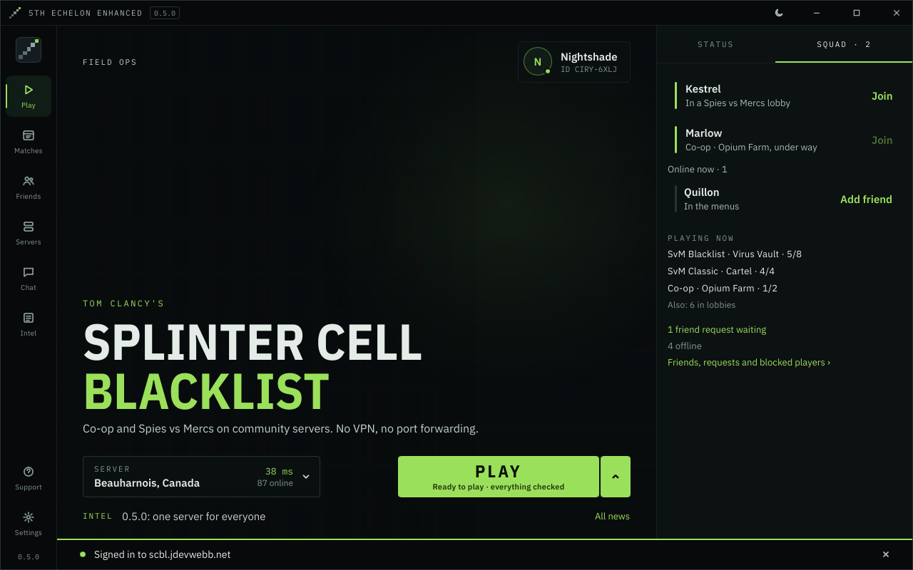

  

<h1 align="center">5th Echelon Enhanced</h1>

  <b>Community servers for <i>Tom Clancy's Splinter Cell: Blacklist</i> multiplayer, and a launcher that sets the game up for you.</b> 
  Co-op and Spies vs Mercs, years after the official servers went dark.

  

  <a href="#the-community-server"><b>Community server</b></a> ·
  <a href="#play-in-five-minutes">Play</a> ·
  <a href="https://github.com/JDevWebb/5th-echelon-enhanced/wiki"><b>Wiki</b></a> ·
  <a href="#run-your-own-server">Run your own</a> ·
  <a href="#features">Features</a> ·
  <a href="#contributing">Contribute</a> ·
  <a href="#community">Community</a> ·
  <a href="#support-the-community-servers">Support the servers</a>

---
## The community server

**There is a public 5th Echelon server that anyone can play on, for free.** Get the launcher and press Connect: everyone signs in to the same server, so every search finds the whole community, and your game plays through the relay nearest you.

<table>
<tr><td><b>Address</b></td><td><code>scbl.jdevwebb.net</code>: the community network, the launcher's default; there's nothing to type</td></tr>
<tr><td><b>Matchmaking</b></td><td>One matchmaking server for everyone (Beauharnois, Canada): accounts, friends, invites and every search, so players from every region find each other</td></tr>
<tr><td><b>Relays</b></td><td>Near the players: Europe (Falkenstein, Germany), North America (Beauharnois, Canada) and Oceania (Sydney, Australia). The launcher pings each and the game uses the nearest; matches still run between the players</td></tr>
<tr><td><b>Modes</b></td><td>Co-op and Spies vs Mercs: Find Teammate, Quick Match, lobby and private-match invites</td></tr>
<tr><td><b>Friends</b></td><td>Friends-only lists and invites, joining a friend's game without an invite, blocking, player search, and chat</td></tr>
<tr><td><b>Internet play</b></td><td>No VPN or port forwarding: the server tells your game its public address, and relays matches when a router can't be reached</td></tr>
<tr><td><b>Your account</b></td><td>No password to remember: your launcher's identity finds your account, from any PC</td></tr>
<tr><td><b>Fair play</b></td><td>Bans that hold for the PC, report-only checks on the game's clock, code and files, other players' games noticing impossible movement, and match recordings the admins can replay when you report a player</td></tr>
<tr><td><b>Security</b></td><td>Sign-ins never travel unencrypted; your account gets its own random password; the launcher and the servers install only releases signed with the release key, and the servers update themselves</td></tr>
</table>

### Play in five minutes

You need **Splinter Cell: Blacklist on PC** (Steam or Ubisoft Connect), on Windows 10 or 11, Linux or a Steam Deck.

1. **Download** `launcher.exe` (Windows) or `launcher-linux-x86_64` (Linux, Steam Deck) from the [latest release](https://github.com/JDevWebb/5th-echelon-enhanced/releases/latest). It's one file; put it anywhere.
2. **Run it.** It finds the game by itself (Steam libraries, Ubisoft Connect, the usual folders), and the community server is already picked.
3. **Press Connect** (the first time, choose the name other players will see), **then Play.**
4. **In the game, press <kbd>F5</kbd>** for friends, chat and invites (<kbd>Fn</kbd>+<kbd>F5</kbd> on most laptops, or choose another key in **Settings › Game**).

No VPN or port forwarding is needed: each time the game starts, the launcher pings the network's relays and the game uses the nearest. Played on the community network before 0.5.0, on one of its regional servers? The launcher moves you to the matchmaking server by itself, with your name, friends, stats and save. Coming from upstream 5th Echelon? Use this launcher instead; your saves carry over ([how](https://github.com/JDevWebb/5th-echelon-enhanced/wiki/Coming-from-5th-Echelon)).

  

**Something not working?** The **Status** card on the Play screen has a button for each problem, and **Settings › Network › Connection test** checks each part in turn. The wiki has the rest: [Getting started](https://github.com/JDevWebb/5th-echelon-enhanced/wiki/Getting-Started), [Linux and Steam Deck](https://github.com/JDevWebb/5th-echelon-enhanced/wiki/Linux-and-Steam-Deck), [Playing over the internet](https://github.com/JDevWebb/5th-echelon-enhanced/wiki/Playing-Over-the-Internet), [Troubleshooting](https://github.com/JDevWebb/5th-echelon-enhanced/wiki/Troubleshooting) and the [FAQ](https://github.com/JDevWebb/5th-echelon-enhanced/wiki/FAQ).

### Antivirus warnings

Some antivirus programs, Microsoft Defender included, may flag `launcher.exe` or `uplay_r1_loader.dll` (names like `Trojan:Win32/Wacatac.H!ml`). **These are false positives:** the launcher installs a DLL that hooks the game to talk to community servers, as cheats do, and the files aren't code-signed yet. Get the launcher only from this repository's [releases](https://github.com/JDevWebb/5th-echelon-enhanced/releases) and check it against the release's `SHA256SUMS`. If it was quarantined, restore it and exclude its folder and the game's `src\SYSTEM` folder: **[step by step in the wiki](https://github.com/JDevWebb/5th-echelon-enhanced/wiki/Antivirus-Warnings)**.

### What's sent, and when

Reports go to your server's admins only if you agree, and the game sends the server you play on its diagnostics, crash reports included, so problems get fixed even when nobody reports them. Your user folder, PC and account names and internet address are hidden first, and **Settings › Feedback** turns it off. Exactly what goes: [Reporting a problem](https://github.com/JDevWebb/5th-echelon-enhanced/wiki/Reporting-a-Problem).

### Support the community servers

> [!TIP]
> **5th Echelon Enhanced is free, and always will be.** If you'd like to, you can chip in towards **hosting the community servers** (the servers and relays, about **US$40 a month**). It's entirely optional: there are no perks, and any amount is appreciated.
>
> 

### Run your own server

The community network is a service the project's maintainer runs with this software; everything it runs is in this repository. **Run your own** for your group, on any small Linux VPS, with one script: `install-server.sh`, from the latest release. It runs as root, so check it against the release's signed checksums first; [docs/deploying.md](docs/deploying.md#get-the-installer) has a block to paste that downloads it, checks the release key's signature and the installer's checksum, and only then runs it.

Then choose how it fits in:

- **Start a network of your own.** Run your own coordinator: on the same machine as your server (choose "run a coordinator here too"), or on a machine of its own (`--coordinator-only`). Your community gets its own directory and its own friends, completely independent of the community network. Pass the join token to the servers you trust. You get the same automatic updates for your servers, and an admin UI of your own ([docs/operations.md](docs/operations.md)).
- **Grow it into one matchmaking server with relays,** as the community network is: every player signs in to one server, and small relay-only servers near each region's players carry their matches when a router can't be reached ([docs/deploying.md](docs/deploying.md#one-matchmaking-server-with-relays)).
- **Or keep it to yourselves:** a server on its own, for a group of friends or a LAN.

The step-by-step guide, with DNS (Cloudflare included), firewalls, sizing and troubleshooting: **[docs/deploying.md](docs/deploying.md)**.

Tell us how it goes: bugs, ideas and questions are all welcome as [issues](https://github.com/JDevWebb/5th-echelon-enhanced/issues), and the [Discords below](#community) are the place to find players.

---

## Features

- **Online co-op and Spies vs Mercs:** Find Teammate, Quick Match, lobby invites and invites into private matches, with a Matches tab of every public match.
- **Internet play without a VPN:** public addresses from the server, router port forwarding, and relays near every region when a router can't be reached.
- **A guided setup:** game detection, the client installed, your account found or made with your identity, your save brought over (or a rank 5 one), then a Status card with a fix for each problem.
- **An in-game overlay:** friends and what they're playing, requests, player search and blocking, chat, invites and lobby limits.
- **One identity, every server:** no username or password to remember; friends follow you between a network's servers.
- **Fixes for the game's own crashes,** patched in memory, and crash reports that get the rest fixed.
- **Fair play:** bans that hold for the PC, report-only checks, and match recordings the admins can replay.
- **Linux and Steam Deck:** a native Linux launcher, and Proton and Wine support in the client.
- **Signed updates** for the launcher and the servers, checked against the release key.
- **For server operators:** one-script installs, a network of servers sharing friends through a coordinator, automatic updates in booked windows, backups, failover and an admin UI.

Every feature, for players and for operators: **[docs/features.md](docs/features.md)**.

## What's new since 5th Echelon

5th Echelon Enhanced began as a fork of [5th Echelon 0.2.5](https://github.com/unixoide/5th-echelon/releases/tag/v0.2.5) and is now developed as a project of its own: a new launcher, internet play without a VPN, friends and identities across servers, the community network, and much more. The full list, with where each change came from: **[docs/whats-new-since-5th-echelon.md](docs/whats-new-since-5th-echelon.md)**. Each release's notes are on the [releases](https://github.com/JDevWebb/5th-echelon-enhanced/releases) page.

## Documentation

| For | Where |
|---|---|
| **Players** | The **[wiki](https://github.com/JDevWebb/5th-echelon-enhanced/wiki)**: [getting started](https://github.com/JDevWebb/5th-echelon-enhanced/wiki/Getting-Started), [the launcher](https://github.com/JDevWebb/5th-echelon-enhanced/wiki/The-Launcher), [the overlay](https://github.com/JDevWebb/5th-echelon-enhanced/wiki/The-In-Game-Overlay), [friends and invites](https://github.com/JDevWebb/5th-echelon-enhanced/wiki/Friends-and-Invites), [chat](https://github.com/JDevWebb/5th-echelon-enhanced/wiki/Chat), [save games](https://github.com/JDevWebb/5th-echelon-enhanced/wiki/Save-Games), [troubleshooting](https://github.com/JDevWebb/5th-echelon-enhanced/wiki/Troubleshooting) and the [FAQ](https://github.com/JDevWebb/5th-echelon-enhanced/wiki/FAQ) |
| **Hosting a server** | [Hosting a server](https://github.com/JDevWebb/5th-echelon-enhanced/wiki/Hosting-a-Server) and [Running a network](https://github.com/JDevWebb/5th-echelon-enhanced/wiki/Running-a-Network) in the wiki; [docs/deploying.md](docs/deploying.md) step by step; [docs/hosting.md](docs/hosting.md) for Windows, Linux, Docker and a reverse proxy; [docs/server-settings.md](docs/server-settings.md) |
| **Running a network** | [docs/operations.md](docs/operations.md) (updates, the admin UI, alerts), [docs/backups.md](docs/backups.md), [docs/failover.md](docs/failover.md), [docs/cutover.md](docs/cutover.md) |
| **Developers** | [CONTRIBUTING.md](CONTRIBUTING.md), [docs/building.md](docs/building.md) (building, releases and CI, the project's layout, research tools), the [roadmap](docs/roadmap.md) |

---

## Standing on the shoulders of

**5th Echelon Enhanced is developed by [JDevWebb](https://github.com/JDevWebb), building on [5th Echelon](https://github.com/unixoide/5th-echelon) by [unixoide](https://github.com/unixoide).** unixoide reverse-engineered the game's Quazal online stack, wrote the server, the launcher and the game hook, and documented the protocols in the [5th Echelon reference](https://unixoide.github.io/5th-echelon). None of 5th Echelon Enhanced would exist without that work. It began as a fork of 5th Echelon 0.2.5 and is now developed as a project of its own; upstream's history and its authors are kept in this repository.

### Authors and contributors

| | Contribution |
|---|---|
| **[unixoide](https://github.com/unixoide)** | Created 5th Echelon: the dedicated server, the Quazal/PRUDP/RMC implementation, the launcher, the game hook and the protocol research |
| **[Matthias Walther (MPW1412)](https://github.com/MPW1412)** | Invites into private matches, worked out in the game itself ([#123](https://github.com/unixoide/5th-echelon/pull/123)); the DLL version parser building on any OS ([#124](https://github.com/unixoide/5th-echelon/pull/124)); the Linux findings on CD keys and many-core CPUs ([#98](https://github.com/unixoide/5th-echelon/issues/98)); joining a friend's game without an invite ([#6](https://github.com/JDevWebb/5th-echelon-enhanced/pull/6)) |
| **[Thiago (Thiagogob)](https://github.com/Thiagogob)** | Found why the game says "service not available" under Wine/Proton, and fixed it by emulating the network check Wine lacks ([#128](https://github.com/unixoide/5th-echelon/pull/128)); the reason Linux and Steam Deck work |
| **[Sergey P. (ThirteenAG)](https://github.com/ThirteenAG)** | Contributions to upstream 5th Echelon |
| **[koteykaby](https://github.com/koteykaby)** | Contributions to upstream 5th Echelon |
| **[Michał Kapała (michal-kapala)](https://github.com/michal-kapala)** | Contributions to upstream 5th Echelon, and co-author of [GROBackendWV](https://github.com/zeroKilo/GROBackendWV) |
| **[Askorbinovaya Kislota](https://github.com/askorbinovaya-kislota)** | Contributions to upstream 5th Echelon |
| **[zeroKilo](https://github.com/zeroKilo)** | [GROBackendWV](https://github.com/zeroKilo/GROBackendWV), which shares parts of the protocol and helped get 5th Echelon started |
| **[JDevWebb](https://github.com/JDevWebb)** | 5th Echelon Enhanced: the new launcher, automatic setup, internet play without a VPN, friends, identities and the coordinator, the network's automatic updates and admin UI, server hardening and the security audit, the community API, and the community network |

Every upstream commit keeps its original author in this repository's history, and merged pull requests keep their authors' commits. The [changelog](docs/whats-new-since-5th-echelon.md) lists what 5th Echelon Enhanced changed and where each change came from.

Also used: [IBM Plex](https://github.com/IBM/plex) Sans, Sans Condensed and Mono (SIL Open Font License) for the overlay and launcher, [Slint](https://slint.dev) for the launcher (under its royalty-free licence), and [hudhook](https://github.com/veeenu/hudhook) with [Dear ImGui](https://github.com/ocornut/imgui) for the overlay.

**Want your name here?** See [Contributing](#contributing). Fixes, testing reports, research and documentation all count.

### Become a collaborator

**Already authored commits to 5th Echelon,** here or upstream (code, pull requests, fixes)? You're welcome as a collaborator: [open an issue](https://github.com/JDevWebb/5th-echelon-enhanced/issues/new) asking to be added, and I'll add you.

**New to the project** but want to help run it (reviewing pull requests, triaging issues, testing releases)? Open an issue saying a little about yourself and what you'd like to help with.

---

## Contributing

Contributions of every size are welcome: bug reports with logs, testing with friends, protocol research, documentation, and code. **[CONTRIBUTING.md](CONTRIBUTING.md)** has the details: how to report a problem so it can be fixed, how to build and test, and the project's conventions.

- **Bugs:** [open an issue](https://github.com/JDevWebb/5th-echelon-enhanced/issues/new/choose) and pick the form that fits (a game or launcher problem, a connection problem, your own server). For a connection problem, send the launcher's report (**Settings › Feedback › Send feedback**) right after it happens, and give the time with your time zone.
- **Pull requests:** keep them focused, and describe how you tested.
  - CI builds and tests every pull request on Linux and Windows. Run `build/build.sh test` and, for server changes, `build/build.sh bots` locally first (add a scenario to `tools/testbot` for new server behaviour). Format with `build/build.sh fmt`.
  - Changes that affect the game should say whether they were tried in the game itself.
- **Credit:** your commits keep your name, and you'll be listed under [Authors and contributors](#authors-and-contributors).
- **Upstream:** fixes that apply to upstream 5th Echelon are offered there as well.
- **Collaborators:** see [Become a collaborator](#become-a-collaborator).
- **What to work on:** the [roadmap](docs/roadmap.md) has what's planned next.
- **Servers:** running one for your group is one of the best ways to help. List a public one in [docs/community-servers.md](docs/community-servers.md).
- **Security:** found a weakness? Please don't post it in a public issue: report it privately, as [SECURITY.md](SECURITY.md) describes.

Never commit game files or anything extracted from them. Facts learned from the game (IDs, names, protocol layouts) are fine.

---

## Community

**Play on the [community server](#the-community-server)** at `scbl.jdevwebb.net`, or [run your own](#run-your-own-server). Public servers run by others are listed in [docs/community-servers.md](docs/community-servers.md). What's coming next is in the **[roadmap](docs/roadmap.md)**.

Find other players, active servers and help:

- [Spy vs Merc Community](https://discord.com/invite/YgccjKPUNm)
- [Splinter Cell Community Hub](https://discord.com/invite/ubX9D9v)
- [/r/SplinterCell](https://discord.gg/ywdszwF)
- [SCBL Multiplayer](https://discord.gg/uJH5Sv5Zw3)

## Disclaimer

**5th Echelon Enhanced is free software provided "as is", without warranty of any kind,** express or implied, including fitness for a particular purpose. You use it, and the community servers, at your own risk: no one involved is liable for any damage or loss, to your game, your saves, your PC or anything else, arising from them.

- **The game:** the launcher changes your game's files (it installs a DLL, keeping the original so you can undo it) and your saves (with backups). Keep your own backups of anything you care about.
- **The community servers:** a free service with no guarantee. They can be down, reset or shut down at any time, and accounts, friends and stats on them can be lost.
- **Not affiliated with Ubisoft:** this is a fan project, not affiliated with, endorsed by or connected to Ubisoft. *Tom Clancy's Splinter Cell: Blacklist* and its names and marks belong to Ubisoft. You need your own copy of the game.

## Licence

**5th Echelon Enhanced's own work is under the MIT licence; upstream's code isn't licensed yet.** Licensing follows who wrote each line, as the git history records it ([LICENSE.md](LICENSE.md) has the details and where upstream's code is):

- **MIT:** everything this project wrote (about 60 % of the lines, and nearly all of the coordinator, the launcher, the network's matchmaking and relays, fair play and the installer), and contributions made to this repository, such as Matthias Walther's host migration, quick start and Linux work.
- **Not MIT:**
  - upstream 5th Echelon's code (about 35 % of the lines, two thirds of it protocol dumps, name tables, the base save and research tools; in the programs, mostly the game's protocol definitions), which has no licence yet ([unixoide/5th-echelon#129](https://github.com/unixoide/5th-echelon/issues/129)) and remains its authors';
  - pull requests made to upstream and carried over, which stay their authors': [#123](https://github.com/unixoide/5th-echelon/pull/123) and [#124](https://github.com/unixoide/5th-echelon/pull/124) by Matthias Walther, [#128](https://github.com/unixoide/5th-echelon/pull/128) by Thiago;
  - third-party material: the vendored hudhook (MIT), Slint (royalty-free licence), the IBM Plex fonts (SIL Open Font License), the admin UI's world map (Natural Earth, public domain) and DB-IP's city database (CC BY 4.0, downloaded at run time).
- **Not software:** the [community network](#the-community-server) (its servers, coordinator and admin UI) is a service run with this code; the licence doesn't cover it or access to it.

Contributions are accepted under MIT unless a pull request says otherwise.

*Splinter Cell and Splinter Cell: Blacklist are trademarks of Ubisoft Entertainment. This project is not affiliated with or endorsed by Ubisoft, and ships no game files: you need your own copy of the game.*
