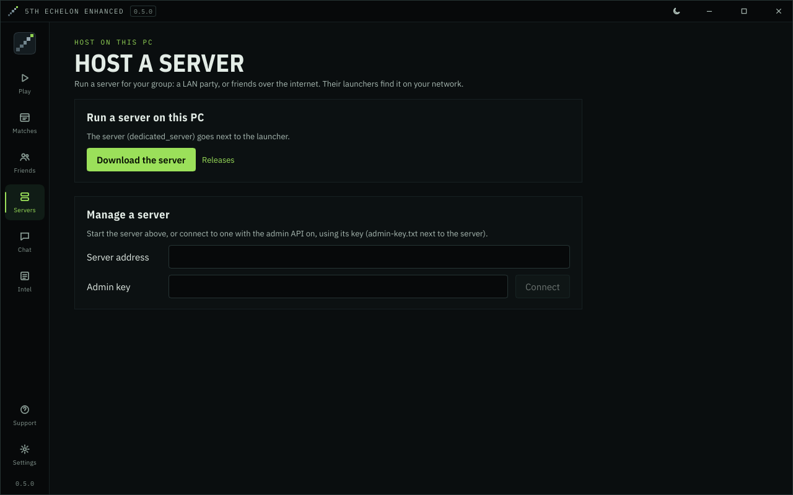

<!-- Moved from the README (2026-11-10), unchanged. The step-by-step guide is docs/deploying.md. -->
# Host a server

Players need to reach these ports on the server:

| Port | Protocol | What |
|---|---|---|
| 80 | TCP | The game's online configuration, and the community API. **The game always uses port 80.** |
| 443 | TCP | The launcher's API over HTTPS, and a coordinator (with the Linux installer's Caddy) |
| 8000 | TCP | Content (multiplayer balancing) |
| 21126 | UDP | Game login |
| 21127 | UDP | Game service |
| 21128–21129 | UDP | Internet play: players' public addresses, and the relay |
| 50051 | TCP | Accounts, friends and invites (the launcher and overlay); behind Caddy it's served on 80 and 443 instead |

Matches run **peer to peer** between players. The server's NAT helper (21128–21129) lets them reach each other over the internet, and relays matches for players whose routers can't be reached directly. Relayed matches use roughly 20–60 KB/s per player on the server; see [`[nat]`](server-settings.md#nat-internet-play-without-a-vpn) to limit or switch it off.

**The public address** is the one thing every server needs set: the address players connect to. Without it, the server tells players to connect to `127.0.0.1`. Use:
- your **public IP**, with the ports above forwarded to the server;
- or the server's **VPN address**, if everyone plays over one VPN.

## On Windows: from the launcher (easiest)

1. Open the launcher's **Host** screen. If `dedicated_server.exe` isn't next to the launcher, press **Download the server**.
2. Choose what to **listen on** (every address is fine), and fill in the **public address** if players come in through port forwarding.
3. Switch on the community API parts you want, then press **Start server**.

The launcher stops the server when it closes. The **Manage a server** section lists players and games, and shows the log.

<p align="center">
  
</p>

## On Windows: on its own

For a server that keeps running without the launcher (e.g. as a scheduled task or service):

1. Put `dedicated_server.exe` from the [release](https://github.com/JDevWebb/5th-echelon-enhanced/releases/latest) in its own folder, e.g. `C:\5th-echelon`.
2. Allow the ports through Windows Firewall, from an administrator PowerShell:
   ```powershell
   New-NetFirewallRule -DisplayName "5th Echelon (TCP)" -Direction Inbound -Protocol TCP -LocalPort 80,8000,50051 -Action Allow
   New-NetFirewallRule -DisplayName "5th Echelon (UDP)" -Direction Inbound -Protocol UDP -LocalPort 21126-21129 -Action Allow
   ```
3. Start it from that folder with the address players connect to:
   ```powershell
   cd C:\5th-echelon
   .\dedicated_server.exe --public-address 203.0.113.10
   ```

The first start writes `service.toml` (the settings) and creates the database, keys and `data\` folder next to it.

## On Linux

**The quick way:** one script installs the server as a systemd service on a fresh VPS. It detects Debian, Ubuntu, Fedora, Rocky/Alma or Arch, and can put Caddy in front on a domain name. The full guide is **[docs/deploying.md](deploying.md)**.

Get `install-server.sh` from the latest release (it's one of its downloads, covered by the release's signature) and check it before running it as root: **[Get the installer](deploying.md#get-the-installer)** has the commands, which stop unless the signature and the checksum both check out. Then:

```sh
sudo bash install-server.sh
```

- **It asks for a domain name**, e.g. `blacklist.example.com`, with an A record pointing at the server (on Cloudflare: DNS only, not proxied). With one, Caddy serves the game's web parts on port 80 and the launcher's API over HTTPS on 443, so only TCP 80 and 443 and UDP 21126–21129 need to be open. Leave it empty to skip Caddy.
- **It asks whether to share friends:** keep the server on its own, run a coordinator here too, or join a coordinator your group runs elsewhere.
- **It then:**
  - downloads the latest release, and checks its checksum and the release key's signature;
  - creates a system user and a sandboxed service;
  - gets certificates, and switches the launcher's API to HTTPS once they work;
  - opens the ports in ufw or firewalld, if either is active;
  - lists the ports to open on your provider's firewall.
- **Friend lists are friends-only** on a new install (`--friends mutual`) unless you choose `--friends everyone`.
- **Without questions:** `--domain`, `--coordinator-domain` (run a coordinator here), `--coordinator` and `--join-token-file` (join one), `--coordinator-only` (a coordinator and no game server), `--server-name`, `--region`, `--alias`, `--admin`, `--closed-registration`, `--unlisted` and `--yes`.
- **Looking after it:** `--status` shows what's running, whether it has joined its coordinator, and the updater's last result; `--show-join-token` and `--rotate-join-token` manage a coordinator's token.
- **Updates:** in a network, the server installs the coordinator's signed releases by itself (`--no-auto-update` turns that off, and a network then delists it). Every account needs a player identity on a new install (`[limits] require_identity`).
- **The machine:** `scripts/harden-host.sh` hardens the rest of the host. See [Hardening the machine](deploying.md#hardening-the-machine).
- **The admin UI:** `--metrics-domain` (with a Cloudflare Origin CA certificate: `--metrics-cert`, `--metrics-key`) turns on a coordinator's admin UI, served only through Cloudflare. `--add-admin` invites an admin, and `--reset-admin` gives one a new setup link. See [docs/operations.md](operations.md).
- **Running it again updates the server**, keeping accounts and settings (anything not given again stays as it was). `--uninstall` removes it and the firewall rules it added, and `--help` lists the rest.

**By hand:**

1. Download `dedicated_server-linux-x86_64` from the [release](https://github.com/JDevWebb/5th-echelon-enhanced/releases/latest), or [build it](building.md#build-from-source).
2. Give it a folder and a user of its own:
   ```sh
   sudo useradd --system --home /srv/5th-echelon --create-home 5th-echelon
   sudo install -m 755 dedicated_server-linux-x86_64 /srv/5th-echelon/dedicated_server
   ```
3. Port 80 is privileged. Let the server bind it without running as root:
   ```sh
   sudo setcap cap_net_bind_service=+ep /srv/5th-echelon/dedicated_server
   ```
4. Run it under systemd, as `/etc/systemd/system/5th-echelon.service`:
   ```ini
   [Unit]
   Description=5th Echelon server
   After=network-online.target
   Wants=network-online.target

   [Service]
   User=5th-echelon
   WorkingDirectory=/srv/5th-echelon
   Environment=FE_PUBLIC_ADDRESS=203.0.113.10
   ExecStart=/srv/5th-echelon/dedicated_server
   Restart=always

   [Install]
   WantedBy=multi-user.target
   ```
   ```sh
   sudo systemctl enable --now 5th-echelon
   journalctl -u 5th-echelon -f
   ```
5. Open the ports in your firewall, e.g. with ufw:
   ```sh
   sudo ufw allow 80,8000,50051/tcp && sudo ufw allow 21126:21129/udp
   ```

The server exits if one of its services stops, so systemd's `Restart=always` brings it straight back.

## With Docker

Every signed release publishes the server's image to GitHub's container registry (`:latest`, or a release's version; `-unsigned` tags are builds nobody has signed off yet). The release key signs the image's digest along with the release (`IMAGE` and `IMAGE.sig` among its downloads), after checking it was built by this repository's release workflow from the release's tag. To run exactly the image that was signed, whatever its tags say, check it and run it by its digest: `scripts/verify-image.sh v0.4.3` prints `ghcr.io/jdevwebb/5th-echelon-server@sha256:…` once the signature checks out (on Linux, with curl and OpenSSL 3).

```sh
docker run -d --name 5th-echelon --restart unless-stopped \
  -e FE_PUBLIC_ADDRESS=203.0.113.10 \
  -p 80:80 -p 8000:8000 -p 21126-21129:21126-21129/udp -p 50051:50051 \
  -v 5th-echelon:/srv/5th-echelon \
  ghcr.io/jdevwebb/5th-echelon-server:latest
```

Or build it yourself with Compose, from a clone of this repository:

```sh
FE_PUBLIC_ADDRESS=203.0.113.10 docker compose -f docker/compose.yaml up -d
docker compose -f docker/compose.yaml logs -f
```

- It builds the server from source, publishes the ports above, and keeps everything it writes in the `data` volume: the database, keys, `service.toml` and `data/`. Nothing is lost when the container is rebuilt.
- The image has a health check on the API port, and the server runs as a user of its own with only the right to bind port 80. The compose file also makes the image read-only and drops every other privilege.
- The NAT helper needs to see players' real addresses. Docker on Linux keeps them; **Docker Desktop** (Windows, macOS) replaces them with its own, so run the server directly there, or use host networking.
- `FE_LISTEN` (default: every address) chooses the address to listen on.

To edit the settings, change `service.toml` in the volume and restart:

```sh
docker compose -f docker/compose.yaml exec server sh -c 'cat service.toml'
docker compose -f docker/compose.yaml restart
```

## Behind a reverse proxy

Running other services on the same machine? Everything TCP (the game's config on port 80, content and the API) can share port 80 with your other sites through **Caddy**, by host name. The UDP ports move to any free numbers. Set `[public]` in `service.toml` to what players connect to. The launcher reads it from the server, so players still only type the host name.

The guide, with a tested Caddyfile: **[docs/reverse-proxy.md](reverse-proxy.md)**.

## Settings

The server reads `service.toml` from its working folder, writing the defaults on the first start. The settings 5th Echelon Enhanced adds are in **[docs/server-settings.md](server-settings.md)**:

- **`[community_api]`:** server info, who's online, sign-up for tools, unhandled calls. Only server info is on by default.
- **`trusted_subnet`:** fixes joins when players' games advertise the wrong network adapter (e.g. everyone on one VPN).
- **`[limits]`:** failed logins and new accounts per address, whether new accounts are allowed, and whether every account needs a player identity (`require_identity`).
- **`[admin]`:** the admin API for the launcher's **Manage a server**. Its key is written to `admin-key.txt`.
- **`[nat]`:** internet play: the NAT helper's port, and who is relayed (`auto`, `all` or `off`) and how fast.
- **`[public]`:** the host name and ports players connect to, when they differ from what the server listens on (a reverse proxy, remapped ports), and which proxies' `X-Forwarded-For` to trust.
- **`[friends]`:** every player on the friend list (`everyone`, the default) or only friends (`mutual`).
- **`[clients]`:** the oldest launcher and client allowed to sign in (default: this server's own release; `"off"` for any).
- **`[federation]`:** a coordinator to share friends with other servers, this server's name and region in its directory, and whether it installs the network's releases (`auto_update`).

Command-line options: `--public-address <ip>`, `--listen <ip>`, and `-c <file>` for another settings file. The first two are also the `FE_PUBLIC_ADDRESS` and `FE_LISTEN` environment variables. The address options rewrite `service.toml` on every start, so the addresses always match.

---

<a id="whats-new-in-this-fork"></a>
